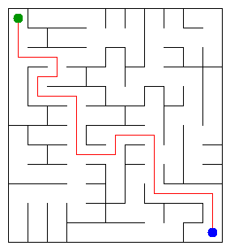

# Assignment 3. Maze Escape

Student ID: 252373
Name: Sanzhar Zhunis
Group: SE-2519
Maze size (rows x columns): 11 x 12

This file is the report. How to start: `START_HERE.md`. The task: `docs/Assignment3.pdf`.

## Program output

The 13 lines my program prints on my data (`java -cp out Main`):

    Broken: 131
    Kept: 110
    Last broken wall: 210
    MST cost: 40572
    Heaviest broken wall: 878
    Path length: 25
    DFS visited: 85
    Dead ends: 44
    Zones: 10
    Largest zone: 25
    Is DAG: 0
    Flow stages: 6
    Fastest route cost: 6

`java tools/Check.java` shows that all 3 examples (tiny, small, dag) are right, and the DisjointSetTest passes.

My maze:

## Questions

Mission 0. What do find and union do, and what makes them fast in your code?

find(x) returns the root of the set of x. It walks up from x to the root, and then walks the same way a second time and makes every cell on the way point directly to the root (path compression), so the next find on these cells is almost one step. union(a, b) finds the two roots; if they are the same it returns false, otherwise the smaller tree is put under the larger one (union by size) and the number of sets goes down by one. Union by size keeps the trees low and path compression flattens them, so together one operation costs almost constant time (inverse Ackermann). I wrote find with loops and not with recursion, so a very long chain does not overflow the stack.

Mission 1. Why is Broken always R*C - 1, and Kept always (R-1)*(C-1)?

At the start every cell is its own set, so there are R*C sets. A wall is broken only when union returns true, and every such union joins two sets into one, so the number of sets goes down by exactly one each time. All the cells of the grid can be connected through the inner walls, so we end with one set, which needs R*C - 1 successful unions. That is Broken. The number of inner walls is R*(C-1) + (R-1)*C = 2RC - R - C, and Kept = 2RC - R - C - (RC - 1) = RC - R - C + 1 = (R-1)*(C-1). For my maze: 11*12 - 1 = 131 broken and 10*11 = 110 kept.

Mission 2. My MST cost from Kruskal and from Prim, and why they are equal:

Both give 40572. All wall costs are different, so the cheapest maze is only one (unique). Kruskal always takes the cheapest wall that does not make a cycle, and Prim always takes the cheapest wall that goes out of the part of the maze that is already built. Both choices are safe by the cut property (the cheapest wall across any cut belongs to the minimum tree), so both build the same tree and the same total cost.

Mission 3. Why is there exactly one path between two cells? How did you avoid a stack overflow on a huge maze?

In Mission 1 a wall is broken only when its two cells are in different sets, so a broken wall never closes a cycle. The maze of broken walls is connected (one set) and has R*C - 1 edges for R*C cells, so it is a tree, and in a tree there is exactly one path between any two cells (one path at least because it is connected, and a second path would make a cycle). To avoid a stack overflow I did not use recursion. The DFS has its own stack in an int array, and for every cell it remembers which of the four directions (up, right, down, left) it tries next, so it can go back to the cell when a branch is a dead end. A maze of 1000 by 1000 cells can be a million cells deep, which would break the normal call stack, but an array is no problem.

Mission 4. Why does the second pass of Kosaraju go on the reversed graph? Why do the slides have no cycle exactly when Zones equals the number of cells?

After the first pass the cell that finished last is in a zone that has no slides coming into it from other zones (a source zone). If I ran the second DFS on the normal slides from this cell, it could go out of the zone into the zones after it and take cells that don't belong to its zone. On the reversed graph the slides between zones go the other way, so from a cell of a source zone the DFS can only reach cells that can reach it, which are exactly the cells of its own zone. Then this zone is taken out, the next cell not yet in a zone is again in a source zone of what is left, and so on. This also gives the zones in topological order, the order of the second pass. About the cycle: a zone is a set of cells that can all reach each other. If there is a cycle, the cells on it reach each other, so they are in one zone with at least 2 cells, and Zones is less than the number of cells. If there is no cycle, no two different cells can reach each other, so every zone has exactly one cell and Zones equals the number of cells.

Mission 5. Why is it enough to go through the zones in the order of their numbers? What does this pass cost?

The zones are numbered in topological order, so every slide between two different zones goes from a smaller number to a larger number. When I come to zone z, all slides that enter z come from zones with smaller numbers, and these were already processed so the longest chain and the cheapest cost for z are already final. I don't need a priority queue like in Dijkstra, because I never have to go back to a zone. I look at every cell and every slide once, and sort the cells by zone with a counting sort so the cost is O(n + m) time and O(n + m) space (n cells, m slides).

## AI use

I used Gemini for fixing some IDE errors and helping me with the explanation of some concepts from this assignment.

## Timing (Mission 7)

Milliseconds, 5 runs each, from `java -cp out Bench`. Average of the 5 runs:

| maze | Kruskal | Prim |
|---|---|---|
| 100 x 100 | 11 | 7 |
| 300 x 300 | 69 | 49 |
| 1000 x 1000 | 954 | 1094 |

The number of walls m is about twice the number of cells, so going from 100x100 to 300x300 gives 9 times more cells and from 300x300 to 1000x1000 about 11 times more. The time grows a bit faster than the number of cells.Kruskal went from 69 ms to 954 ms (about 14 times) and Prim from 49 ms to 1094 ms (about 22 times). This fits O(m log m): Kruskal sorts all the walls and Prim keeps a priority queue with up to 2m entries, and on the big maze the memory is also used less well by the cache. Kruskal is faster than Prim on the biggest maze, while on the small ones the first runs include warm-up time of Java and the numbers are small and noisy.

## Complexity

n is the number of cells, m the number of walls (or slides). In the maze m is about 2n

| algorithm | time | space | assumptions |
|---|---|---|---|
| DSU find and union | O(alpha(n)) per operation, almost constant | O(n) | union by size and path compression |
| Kruskal | O(m log m + m alpha(n)), the sort is the main cost | O(n + m) | all walls sorted by cost, the graph is connected |
| Prim | O(m log m) | O(n + m) | binary heap (PriorityQueue), cells can be put in the queue many times and old ones are skipped, the graph is connected |
| DFS | O(n) | O(n) | the maze is a tree (n - 1 open doors), checking the four directions costs constant time, own stack in an array |
| Kosaraju | O(n + m) | O(n + m) | two DFS passes with explicit stacks, lists of slides in arrays |
| Route in the zone graph | O(n + m) | O(n + m) | zones in topological order, counting sort of the cells by zone, no priority queue |

## Before you submit

- data/walls.txt, data/slides.txt and output/maze.png are in the repository.
- `java tools/Check.java` shows all examples right.
- This README is filled in, the program output and the section AI use included.
- The work is pushed to main (at least one commit per mission) and the repository is public.
- The link is attached in Moodle.
